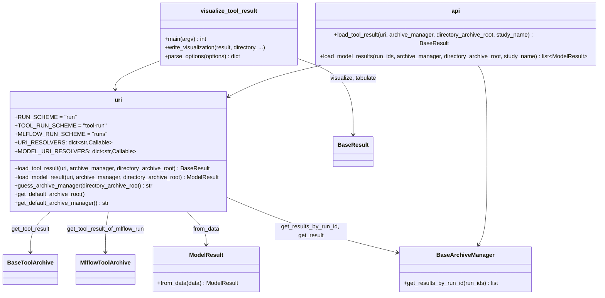

# Load tool results and simulations by reference; visualize_tool_result CLI

## Requirements

- Let users address a tool result by a single string (URI), whatever the archive
  holding it, and load it from Python or from the command line.
- Let users load the simulations used by a tool result from their `run_id`, without
  creating their model.
- Let a reviewer who does not write Python get the figures, tables and metadata of
  tool results in a directory.
- Name the loading functions after what they return, and give them the archive
  settings of the models and the tools (`archive_manager`, `directory_archive_root`,
  SPEC-004), so that loading a model result and loading a tool result read alike
  (review feedback).
- Iteration 2, aligned on SPEC-010 iteration 1: the loading functions and the CLI also
  take `study_name`, the third archive setting (SPEC-011), so that one dict `archive` is
  passed to every function; and the URI module resolves the URIs of the model results
  too (`run:{run_id}`, a job directory, `runs:/{mlflow_run_id}`). SPEC-010 owns the
  need and `vimseo.api.load_model_result`; this canvas owns the URI module and the CLI.
- Out of scope: writing the archives (SPEC-004, SPEC-005), the figures themselves
  (SPEC-006), the reorganization of the examples and the simplification of the
  data roundtrip (SPEC-010).

Acceptance criteria:

- Given `path/to/{tool}_result.hdf5`, a tool run directory
  `{root}/tools/{tool}/{tool_run_id}`, `tool-run:{tool_run_id}` or
  `runs:/{mlflow_run_id}`, when `vimseo.api.load_tool_result(uri, archive_root,
  archive_manager)` is called, then the result is returned.
- Given `tool-run:{id}` without `archive_manager`, then the manager is guessed from
  `archive_root`: a `tools` directory for a directory archive, `0/meta.yaml` for a
  local MLflow database.
- Given a Windows path `C:\...`, then it is read as a path, not as a scheme.
- Given the `simulation_run_ids` of a result, when
  `vimseo.api.load_simulation_results(run_ids, archive_manager, archive_root)` is
  called, then the `ModelResult`s are returned in the same order; a missing one raises
  `KeyError`.
- Given the API after iteration 1, then `load_tool_result(uri, archive_manager,
  directory_archive_root)` and `load_model_results(run_ids, archive_manager,
  directory_archive_root)` take the same archive settings, in the same order, with the
  same names as `IntegratedModelSettings` and the tools; `load_simulation_results` and
  the argument `archive_root` no longer exist.
- Given the docstrings of `BaseToolArchive.get_tool_result` and
  `vimseo.api.load_tool_result`, then each one refers to the other: the first loads a
  result from an archive manager already opened, the second from a URI, without
  opening any archive manager.
- Given `visualize_tool_result --uri <uri> [--uri ...]`, then
  `{output_dir}/{name}/` holds the figures, the tables (CSV) and the metadata of each
  result; `--list-options` prints the visualization settings; `--option key=json`
  sets one.
- Given the API after iteration 2, then `load_tool_result(uri, archive_manager,
  directory_archive_root, study_name)` and `load_model_results(run_ids,
  archive_manager, directory_archive_root, study_name)` accept `study_name`, which does
  not restrict the search: `tool-run:` and `run_id` are searched in every study.
- Given `visualize_tool_result --study-name <study>`, then the option is accepted and
  does not restrict the search, as in the API.
- Given `run:{run_id}`, the path of a job directory or `runs:/{mlflow_run_id}` of a
  simulation, when `uri.load_model_result(uri, archive_manager,
  directory_archive_root)` is called, then the `ModelResult` of that simulation is
  returned.
- Given a URI of a simulation passed to `load_tool_result`, or of a tool run passed to
  `load_model_result`, then a `ValueError` names the other function; given an unknown
  `run:{run_id}`, a `KeyError` names the root searched.

## Entities

## Approach

1. URIs:
   - Four forms: a result file, a tool run directory, `tool-run:{tool_run_id}`,
     `runs:/{mlflow_run_id}` (the MLflow convention).
   - A scheme has at least two characters, so that a drive letter is a path.
   - The schemes are resolved by functions registered in `URI_RESOLVERS`, so that a
     new archive can plug its own scheme.
   - `tool-run:` uses the given manager, else guesses it from the root, else the
     configuration; it also falls back to the archive of the simulations when the tool
     results are not archived (`c7bf6e46`).
2. Simulations by `run_id`:
   - `get_results_by_run_id(run_ids)` on the archives of the simulations searches the
     whole archive, whatever the study (SPEC-011), since a tool result may use several
     models and, through the cache, simulations of another study.
   - `MlflowArchive` creates the experiment of its study with its first run: opening
     it to read no longer creates an empty experiment.
3. Command line:
   - `visualize_tool_result` (entry point in `pyproject.toml`) writes, per URI, the
     figures (`--format html|png|svg`), the tables as CSV and the metadata as JSON;
     `--no-figures`, `--no-tables`.
   - Settings are passed as `--option key=<JSON>` and validated by the result's
     settings class; `--list-options` prints them.
4. Naming and symmetry (review feedback, iteration 1):
   - `load_simulation_results` is renamed `load_model_results`: it returns
     `ModelResult` objects, and the users manipulate "model results" and "tool
     results"; "simulation" stays the name of the run identified by a `run_id`.
   - The archive arguments of `load_tool_result`, `load_model_results`, the
     URI module and the CLI are `archive_manager` then `directory_archive_root`, the
     names and the order of `ArchiveLocationSettings` (SPEC-004). The CLI options are
     `--archive-manager` and `--directory-archive-root`.
   - The two ways to load a tool result are documented together: the method
     `get_tool_result(tool_run_id)` of an archive manager already opened, and
     `vimseo.api.load_tool_result(uri)`, which opens what it needs. The examples show
     them side by side (SPEC-010).
5. The same archive settings everywhere, and URIs for the model results (iteration 2,
   SPEC-010 iteration 1):
   - The loading functions and the CLI take `study_name` after `directory_archive_root`
     (`--study-name`). It does not restrict anything: an identifier is searched in
     every study (SPEC-011 Approach 3). It is accepted so that the user passes the same
     dict `archive` to the models, the tools, the searches and the loads.
   - The URI module resolves both kinds of results, with two registries: `URI_RESOLVERS`
     for the tool results, `MODEL_URI_RESOLVERS` for the model results. `run:{run_id}`
     mirrors `tool-run:{tool_run_id}` and uses `get_results_by_run_id`; a path without
     scheme is a job directory (its `results.json`); `runs:/{mlflow_run_id}` uses
     `MlflowArchive.get_result`. The result is built by `ModelResult.from_data`.
   - `runs:/` and the paths name either kind. Each loader checks the kind first: the
     tag `vimseo.kind` of an MLflow run (SPEC-011), or the files of a directory
     (`results.json` for a simulation, the result HDF5 and summary for a tool run). A
     URI of the other kind raises a `ValueError` naming the right function, before any
     deserialization.
   - The module stays in `storage_management/tool_archive/`: moving it would break the
     imports for a naming gain only; its module docstring says it resolves the URIs of
     both kinds.
6. Rejected alternatives:
   - One function per archive kind: users would need to know where the result is.
   - Always using the configured archive manager for `tool-run:`: it failed with the
     root of an MLflow archive (`286219b3`).
   - Keeping `load_simulation_results` as an alias: the feature is not released, an
     alias would keep two names for one function.
   - A single registry and a `load_result(uri)` returning either kind (iteration 2):
     hides what is returned (SPEC-010 Approach 7).
   - Rejecting `study_name` in the load functions: the user would need one dict to
     write and another to read.

## Structure

### Inheritance Relationships

1. `DirectoryArchive` and `MlflowArchive` implement
   `BaseArchiveManager.get_results_by_run_id`.

### Dependencies

1. `vimseo.api` → `storage_management.tool_archive.uri`, `get_archive_class`.
2. `uri` → `open_tool_archive`, `DirectoryToolArchive`, `load_result_file`; for the
   model results (iteration 2), `get_archive_class`,
   `BaseArchiveManager.get_results_by_run_id`, `MlflowArchive.get_result`,
   `ModelResult.from_data`, and `run_kind.KIND_TAG` (SPEC-011).
3. `visualize_tool_result` → `uri.load_tool_result`, `BaseResult.visualize`,
   `BaseResult.tabulate`.

### Layered Architecture

1. `api.py`: the public entry points (lazy imports).
2. `storage_management/tool_archive/uri.py`: URI resolution, of the tool results and
   (iteration 2) of the model results.
3. `tools/visualize_tool_result.py`: the command line.

## Operations

### Create - `vimseo/storage_management/tool_archive/uri.py`

1. Constants `TOOL_RUN_SCHEME`, `MLFLOW_RUN_SCHEME`, `_SCHEME_PATTERN`.
2. `get_default_archive_root()`, `get_default_archive_manager()`,
   `guess_archive_manager(root)`.
3. `_load_from_tool_run_id`, `_load_from_mlflow_run`, `_load_from_path` (file or tool
   run directory); `URI_RESOLVERS`.
4. `load_tool_result(uri, archive_root="", archive_manager="")`: dispatch on the scheme,
   else path; clear `ValueError`/`KeyError` messages.

### Add - `get_results_by_run_id`

1. `BaseArchiveManager.get_results_by_run_id(run_ids)` (abstract contract and
   docstring), implemented by `DirectoryArchive` and `MlflowArchive`.

### Update - `vimseo/api.py`

1. `load_tool_result(uri, archive_root="", archive_manager="")`.
2. `load_simulation_results(run_ids, archive_manager="", archive_root="")`.

### Create - `vimseo/tools/visualize_tool_result.py`

1. `parse_options`, `get_output_directory_name`, `write_visualization`,
   `_create_parser`, `main(argv) -> int`.
2. Register the entry point `visualize_tool_result` in `pyproject.toml`; document it in
   `docs/user_guide/cli.md` and `CLAUDE.md`.

### Documentation

1. Examples `13_tool_result_management/plot_01_tool_results_in_directories.py` and
   `plot_02_tool_results_in_mlflow.py`.

### Tests

1. `tests/storage_management/test_tool_result_uri.py`,
   `tests/storage_management/test_results_by_run_id.py`,
   `tests/tools/test_visualize_tool_result.py`.

### Iteration 1 (review feedback) - names of the loading API

1. `vimseo/api.py`: rename `load_simulation_results` → `load_model_results`; signatures
   `load_tool_result(uri, archive_manager="", directory_archive_root="")` and
   `load_model_results(run_ids, archive_manager="", directory_archive_root="")`;
   docstrings: "Returns: the model results (`ModelResult`)" and a "See also" pointing to
   `BaseToolArchive.get_tool_result` for `load_tool_result`.
2. `vimseo/storage_management/tool_archive/uri.py`: rename the `archive_root`
   arguments of `load_tool_result`, the resolvers and `guess_archive_manager` to
   `directory_archive_root`, after `archive_manager`; `get_default_archive_root`
   unchanged.
3. `BaseToolArchive.get_tool_result` docstring: "See also `vimseo.api.load_tool_result`,
   to load a result from a URI without opening an archive manager".
4. `vimseo/tools/visualize_tool_result.py`: option `--archive-root` →
   `--directory-archive-root`; update the module docstring examples and
   `docs/user_guide/cli.md`.
5. Callers: examples, tests and `CLAUDE.md` (`load_tool_result(uri)` paragraph).
6. Tests: update the keyword arguments; add a test that `load_model_results` returns
   `ModelResult` objects in the order of the `run_ids`.
7. `CHANGELOG.md`: renamed function and arguments.

### Iteration 2 (SPEC-010 iteration 1) - `study_name` and the URIs of the model results

1. `vimseo/api.py`: `load_tool_result(uri, archive_manager="", directory_archive_root="",
   study_name="")` and `load_model_results(run_ids, archive_manager="",
   directory_archive_root="", study_name="")`; docstring of `study_name`: "Accepted so
   that the same archive settings are passed to every function; the result is searched
   in every study, whatever its value." `load_model_result` itself is added by
   SPEC-010.
2. `vimseo/storage_management/tool_archive/uri.py`:
   - Add `RUN_SCHEME = "run"` and `MODEL_URI_RESOLVERS` (`run` → resolver by `run_id`
     through `get_results_by_run_id` of the archive, `runs` → resolver reading the
     MLflow run with `MlflowArchive.get_result`).
   - Add `load_model_result(uri, archive_manager="", directory_archive_root="")`:
     dispatch on the scheme with the same `_SCHEME_PATTERN`; no scheme: a job directory,
     read from its `results.json`; returns `ModelResult.from_data`. The manager of
     `run:` is resolved as for `tool-run:` (given, else guessed from the root, else the
     configuration).
   - Add a private check of the kind, shared by both loaders: tag `vimseo.kind` for
     `runs:/`, files of the directory for a path. A mismatch raises a `ValueError`
     naming `load_model_result` or `load_tool_result`.
   - Unknown `run:{run_id}`: `KeyError` naming the root searched, as `tool-run:`.
   - Module docstring: the URIs of both kinds, in one table.
3. `vimseo/tools/visualize_tool_result.py`: option `--study-name` (default `""`), passed
   to `load_tool_result`; help: "accepted for symmetry with the other commands; the
   result is searched in every study".
4. Tests:
   - `tests/storage_management/test_model_result_uri.py` (`fast`; MLflow cases skipped
     without the extra): the three forms on both backends, a Windows path, an unknown
     `run_id`, a URI of the wrong kind.
   - `tests/storage_management/test_tool_result_uri.py`: a URI of a simulation raises a
     `ValueError` naming `load_model_result`.
   - `tests/tools/test_visualize_tool_result.py`: `--study-name` accepted.
5. `docs/user_guide/cli.md`: the option `--study-name`.

## Norms

1. The shared norms of `docs/specs/index.md`.
2. Every public loading function is exposed in `vimseo.api`, with lazy imports.
3. A new URI scheme is added to `URI_RESOLVERS` (tool results) or
   `MODEL_URI_RESOLVERS` (model results), never by an `if` in `load_tool_result` or
   `load_model_result`.
4. CLI errors are reported with a non-zero return code and a readable message.
5. A loading function is named `load_<what it returns>`; its archive arguments are
   `archive_manager`, `directory_archive_root`, `study_name`, in this order, in the
   API and the CLI (iteration 2; the private functions of the URI module take the
   first two only).

## Safeguards

1. Functional: a Windows path is never parsed as a URI scheme.
2. Functional: reading an MLflow archive never creates an experiment.
3. Integration: `runs:/` needs the `mlflow` extra; the other forms do not.
4. Performance: `get_results_by_run_id` searches the whole archive.
5. Tests: the three test modules above, on both backends.
6. Breaking change (iteration 1, `refactor!`): `load_simulation_results` →
   `load_model_results`, `archive_root` → `directory_archive_root` in the API and the
   URI module, `--archive-root` → `--directory-archive-root` in the CLI. Not released
   yet: no alias.
7. Compatibility (iteration 2): `study_name` is the fourth parameter of
   `load_tool_result` and `load_model_results`, after `directory_archive_root`;
   existing calls are unchanged. A path or `runs:/` URI that used to be read without a
   check of its kind now fails with a `ValueError` when it is of the other kind,
   instead of a deserialization error.
8. Integration (iteration 2): the check of the kind of a `runs:/` URI imports MLflow
   through `import_optional`; `run_kind` imports nothing from MLflow (SPEC-011), so
   `run:` and paths work in the core profile.

## Open questions

1. Should `load_simulation_results` take the manager and root from the tool result
   (or its archive), instead of the configuration?
2. Should `visualize_tool_result` accept a search (e.g. all the runs of a tool) rather
   than explicit URIs?
3. Is guessing the archive manager from the content of the root directory robust
   enough, e.g. for a remote MLflow server?
4. Should `model.archive_manager.get_results_by_run_id`, which returns raw dicts, also
   return `ModelResult` objects, so that both ways to read simulations give the same
   type? Left to the retro-specification of `JobBundle` (SPEC-009) and to SPEC-010.
5. Should the URI module move out of `tool_archive/`, now that it resolves the model
   results too (e.g. `storage_management/uri.py`)? Not in iteration 2 (Approach 5).
