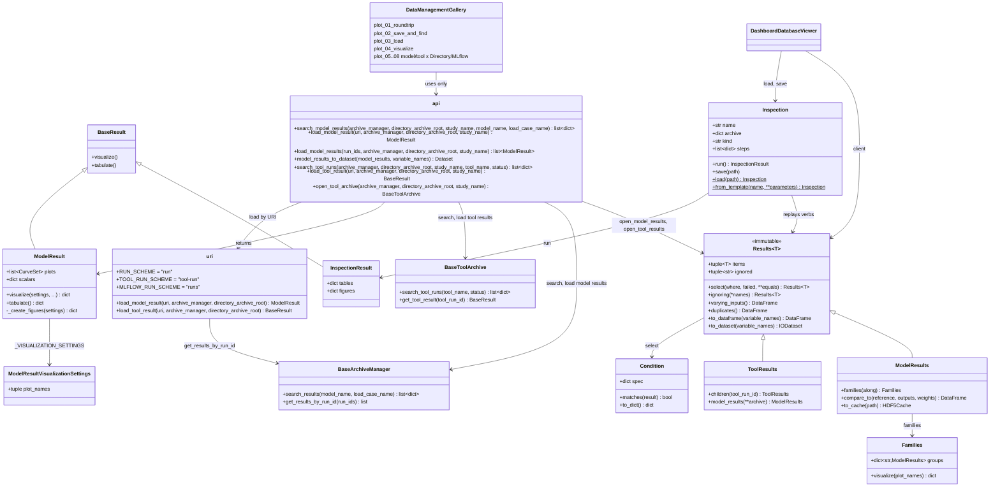

# Data management examples and a symmetric roundtrip of the results

## Requirements

- Teach the roundtrip of the results — generate, save, load, visualize — in a dedicated,
  progressive gallery, from a stripped-down usage example to the backend details, for
  the model results and the tool results.
- Make the roundtrip read the same for a model result and a tool result, and for the
  Directory and MLflow archives: same verbs, same archive settings, same
  `result.visualize()`, so that the user learns one pattern instead of eight.
- Analysis: `spdd/analysis/SPEC-010-202610091207-[Analysis]-data-management-examples-and-roundtrip.md`.
  Decisions taken with the reviewer: the 3 basic examples are split by verb; the API
  simplification is limited to symmetry (no facade class) — revised by iteration 2.
- Iteration 1, after drafting the 8 examples: (1) every data management function of
  `vimseo.api` takes the same three archive arguments, `archive_manager`,
  `directory_archive_root`, `study_name`, so that one dict `archive` is unpacked
  everywhere; (2) a model result is loaded from the `uri` of its summary, as a tool
  result is (Open question 1 resolved: `run:{run_id}` and `load_model_result(uri)`).
- Iteration 2, from the usage of `JobBundle` in 52 study scripts
  (`spdd/analysis/SPEC-009-202610091630-[Analysis]-job-bundle-usage-synthesis.md`) and
  the decision of the owner (2026-10-12): (1) explore a *set* of results through **one
  immutable collection shared by model results and tool results**, whose methods are a
  thin layer over functions; (2) express any selection as **declarative conditions**,
  serializable; (3) **save and replay an inspection** (a sequence of steps on a set of
  results), with predefined inspections drawn from the observed usage; (4) expose
  search, selection and inspections in a **dashboard**, rebuilt from
  `dashboard_database_viewer` as a client of the collection.
- Out of scope: a single `vimseo` CLI, changes of the archive formats, a general
  workflow engine (an inspection only chains the verbs of the collection; tool workflows
  stay in `vimseo.workflow`).

Acceptance criteria:

- Given the doc, then a gallery folder `docs/runnable_examples/14_data_management/` holds,
  in this order: `plot_01_roundtrip` (stripped-down roundtrip and the API table),
  `plot_02_save_and_find`, `plot_03_load`, `plot_04_visualize`,
  `plot_05_model_results_in_directories`, `plot_06_model_results_in_mlflow`,
  `plot_07_tool_results_in_directories`, `plot_08_tool_results_in_mlflow`; the former
  `02_integrated_models/plot_03_model_result_management.py` and
  `13_tool_result_management/` no longer exist. Iteration 2 adds
  `plot_09_inspections`.
- Given `plot_01_roundtrip`, then it has no more than about 60 lines of code, uses only
  `vimseo.api` functions and the objects they return, and shows a table whose rows are
  the verbs and whose columns are model results and tool results, with a note that only
  `archive_manager` changes between Directory and MLflow.
- Given a `ModelResult` loaded from an archive, when `model_result.visualize()` is
  called, then it returns the figures of its `PLOTS` without the model instance; a
  result without plots returns no figure without failing.
- Given `vimseo.api`, then it provides, with the archive arguments `archive_manager`,
  `directory_archive_root`, `study_name` (SPEC-004, SPEC-011), in this order, first
  among the keyword arguments: `search_model_results`, `load_model_result`,
  `load_model_results`, `search_tool_runs`, `load_tool_result`, `open_tool_archive`;
  and `model_results_to_dataset`.
- Given a dict `archive` holding the three archive arguments, then `create_model`, a
  tool constructor and every function above accept `**archive`.
- Given `search_model_results(study_name="layup_A")`, then only the simulations of that
  study are returned; given `study_name=""`, every study. Given a load function, then
  `study_name` is accepted and does not restrict the search: an identifier is searched
  in every study (SPEC-011).
- Given a summary returned by `search_model_results`, when
  `load_model_result(summary["uri"], **archive)` is called, then it returns the
  `ModelResult` of that simulation; the `uri` is `run:{run_id}`, the path of the job
  directory, or `runs:/{mlflow_run_id}`.
- Given the URI of a tool run passed to `load_model_result`, or of a simulation passed to
  `load_tool_result`, then a `ValueError` names the other function.
- Given the examples, then every variable holding `ModelResult` objects is named
  `model_results` (or `model_result`), every variable holding raw archive dicts is named
  `archived_data`, and the archive manager of the tools is `tool_archive_manager`.
- Given `plot_03_load` and `plot_07`/`plot_08`, then `tool_archive_manager.get_tool_result(tool_run_id)`
  and `load_tool_result(uri)` are shown in the same cell, as the two ways to load a tool
  result.
- Given the core profile (no `mlflow` extra), then the doc build skips `plot_06` and
  `plot_08` cleanly, and the other examples run.

Acceptance criteria of iteration 2:

- Given `open_model_results(**archive)`, then a `ModelResults` holds every simulation of
  the archive (of `study_name` if given), loaded without creating any model instance
  beyond what `ModelResult.from_data` needs; `open_tool_results(**archive)` returns a
  `ToolResults` likewise.
- Given a collection, when `select(...)`, `ignoring(...)` or any other verb is called,
  then a new collection is returned and the original one is unchanged; the collection
  has no method that mutates it.
- Given `results.select(model="DebondingENF", where={"inputs:mesh_size": {"lt": 0.5}})`,
  then only the matching results remain; equality shortcuts, `lt`, `le`, `gt`, `ge`,
  `ne`, `in`, `between`, `all` / `any` combinations and `failed=False` are supported; a
  Python callable is accepted as `where=` too, but an inspection holding one cannot be
  saved (`ValueError` naming the step).
- Given `results.ignoring("time_total").varying_inputs()`, then a `DataFrame` lists the
  inputs taking several values, `time_total` excluded, one row per result.
- Given `model_results.families(along="mesh_size")`, then the results are grouped by
  equal values of all their inputs except `mesh_size` (and the ignored ones), each family
  labelled by its differentiating inputs; `families(...).visualize()` returns one figure
  per family and per plot of `PLOTS`, curves labelled by `mesh_size`, sorted by its value.
- Given `results.duplicates()`, then a `DataFrame` lists the groups of results with the
  same inputs; no verb deletes anything; deleting archived runs is only possible through
  an explicit method of the archive manager (REQ-STO-009).
- Given `results.to_dataframe()` / `to_dataset()`, then one row per result with inputs,
  scalar outputs and the metadata columns `date`, `user`, `description`, `cpu_time`,
  `n_cpus`, `cpu_hours` (= `cpu_time × n_cpus / 3600`); vector inputs are supported.
- Given an `Inspection` (archive settings, kind of results, ordered steps) saved with
  `save(path)` and loaded with `Inspection.load(path)`, then `run()` gives the same tables
  and figures on the same archive, and includes the results archived since.
- Given `Inspection.from_template("convergence", along="mesh_size")`, then a predefined
  inspection is returned; the templates are `inventory`, `convergence`, `transverse`,
  `cost_accuracy`, `reload` and `export`.
- Given `dashboard_database_viewer`, then it opens an archive from its settings and a
  study without choosing a model, shows the table of the model results or of the tool
  runs, builds declarative conditions from widgets, shows "what varies" and the families,
  and loads and saves inspections; it calls only the collection and `vimseo.api`.

## Entities

## Approach

1. One pattern, two kinds of results:
   - The roundtrip table of `plot_01` is the specification of the API:

     | Verb | Model results | Tool results |
     |---|---|---|
     | Choose where | `create_model(..., **archive)` | `Tool(**archive)` |
     | Generate and save | `model.execute(...)`, archived automatically | `tool.execute(...)`, archived automatically |
     | Find | `search_model_results(**archive)` | `search_tool_runs(**archive)` |
     | Load | `load_model_result(uri, **archive)`; `load_model_results(run_ids, **archive)` for many | `load_tool_result(uri, **archive)` |
     | Visualize | `model_result.visualize()` | `tool_result.visualize()`, `visualize_tool_result` CLI |
     | Tabulate | `model_results_to_dataset(model_results)`, `model_result.tabulate()` | `tool_result.tabulate()` |
     | Explore a set (iteration 2) | `open_model_results(**archive).select(...).families(along=...)` | `open_tool_results(**archive).select(...)` |
     | Explore | `dashboard_database_viewer`, `dashboard_mlflow` | `dashboard_mlflow`, `visualize_tool_result` |

     Directory and MLflow differ only by `archive_manager`: a cell needing a backend-specific
     function is a defect of the API.
     `archive` is the dict of the three archive arguments, `archive_manager`,
     `directory_archive_root`, `study_name`.
   - The functions are flat functions of `vimseo.api` (REQ-UX-001), lazily importing
     the archives, with the archive arguments of SPEC-004 and SPEC-011 in the same
     order: `archive_manager`, `directory_archive_root`, `study_name`. Each accepts the
     three, so that one dict `archive` is unpacked everywhere (iteration 1):
     - in the search functions, `study_name` filters, empty meaning every study;
     - in the load functions, it is accepted and does not restrict the search, since an
       identifier is searched in every study (SPEC-011 Approach 3);
     - in `open_tool_archive`, it is the study of the tool runs written through the
       returned archive manager.
     Accepting an argument that a load function ignores was preferred to two dicts
     (one to write, one to read), which the user would have to keep in sync.
2. Model results draw themselves:
   - `ModelResult` already stores its figures (`plots`, `CurveSet` with their `Plot`),
     filled by `ModelResult.from_data`. It gains `_create_figures`, drawing each curve set
     with `superpose_curves` as `IntegratedModel._plot_curves` does, and a flat settings
     class `ModelResultVisualizationSettings` (`plot_names`, default all).
   - `IntegratedModel.plot_results` (data `"PLOTS"`) delegates to
     `ModelResult.visualize`, so that the model and the result draw the same figures.
3. Finding model results without the model and without the MLflow API:
   - `BaseArchiveManager.search_results(model_name="", load_case_name="")` returns one
     summary per archived simulation (`run_id`, `model`, `load_case`, `tool_run_id`,
     `datetime`, `uri`), from the `results.json` metadata (Directory) or the tags
     (MLflow), searching the whole archive as `get_results_by_run_id` does.
   - `vimseo.api.search_model_results` opens the archive from its settings and calls it;
     `search_tool_runs` does the same with `open_tool_archive(...).search_tool_runs`.
4. Model results have a URI (iteration 1, Open question 1 resolved):
   - The summary of a simulation carries a `uri`, and `load_model_result(uri)` loads it,
     as `load_tool_result(uri)` loads the summary of a tool run: "find, then load the
     `uri`" reads the same for both kinds.
   - Schemes: `run:{run_id}` (any archive, searched in every study, symmetric to
     `tool-run:{tool_run_id}`), the path of a job directory of a `DirectoryArchive`, and
     `runs:/{mlflow_run_id}` of an `MlflowArchive`. The summaries of
     `search_model_results` give the job directory (Directory) or `runs:/` (MLflow).
   - They are resolved by the URI module of SPEC-007, which gains a registry of model
     result resolvers next to `URI_RESOLVERS`; `run:` uses `get_results_by_run_id` then
     `ModelResult.from_data`.
   - `runs:/` is shared by the two kinds: the resolver reads the tag `vimseo.kind`
     (SPEC-011) and raises a `ValueError` naming the right function when the run is of
     the other kind. A job directory and a tool run directory are told apart by their
     files (`results.json` vs the result HDF5 and summary).
   - `load_model_results(run_ids)` is kept for the batch case, e.g.
     `tool_result.metadata.simulation_run_ids`.
5. Tabular export (idea of `JobBundle.to_dataset`, SPEC-009):
   - `model_results_to_dataset(model_results, variable_names=())` builds an `IODataset`
     of the scalars of the model results (inputs and outputs groups), one row per
     simulation, using `vimseo.utilities.datasets.to_dataset`.
6. The gallery:
   - One folder `14_data_management` (the gallery discovers one level only,
     `docs/gallery_conf.py`), numbered files for the reading order, a `README.md`
     presenting the path: roundtrip → by verb → by backend and kind of result.
   - `plot_01_roundtrip`: one model, one tool (a small DOE), Directory archive; generate,
     find, load, visualize both kinds; the table; one sentence per concept, no internals.
   - `plot_02_save_and_find`: where results go (`archive_manager`,
     `directory_archive_root` and `study_name`, shared by the model and the tools,
     SPEC-011), automatic saving, `search_model_results`, `search_tool_runs` with and
     without `study_name`. `root_directory` is not shown: the working directory is
     created only when a tool writes a file (SPEC-004 iteration 2).
   - `plot_03_load`: `load_model_result` and `load_tool_result` from the `uri` of a
     summary, side by side; `load_tool_result` by URI next to
     `tool_archive_manager.get_tool_result(tool_run_id)`; and from a tool result to its
     model results with `load_model_results(metadata.simulation_run_ids)`.
   - Every example defines one dict `archive` with the three archive arguments and
     unpacks it in every call (`**archive`).
   - `plot_04_visualize`: `visualize()` and `tabulate()` of both kinds, settings, image
     export, the CLI `visualize_tool_result` and the dashboards, in one table "need →
     command".
   - `plot_05`–`plot_08`: the content of the current `plot_03_model_result_management.py`
     (split into Directory and MLflow) and of `13_tool_result_management/`
     (`plot_01`, `plot_02`), rewritten with the API above and the naming of SPEC-004 and
     SPEC-007; the internals (job directory table, MLflow tags mapping, tool run tree,
     links between tool runs and simulations) live here.
7. One collection for sets of results (iteration 2, decision of the owner):
   - `Results[T]` is an immutable, generic collection of results (`T` is `ModelResult`
     or the `BaseResult` of a tool) with the verbs common to both kinds: `select`,
     `ignoring`, `varying_inputs`, `duplicates`, `to_dataframe`, `to_dataset`.
     `ModelResults` adds `families`, `compare_to`, `to_cache`; `ToolResults` adds the
     navigation between tool runs and to their model results.
   - What it brings, from the observed usage (synthesis, patterns P1–P11):
     discoverability (`results.` lists the verbs; users explored folders with
     `JobBundle` for this reason), chaining without re-import (P5: `filter` mutated the
     bundle, scripts re-imported the archive for each value of a factor), context carried
     once (the `ignore` list, P3: inputs overwritten with `"ignored"`), immutability
     enforced by the type, and a readable `repr` as the inventory (P6).
   - The functions are the implementation, in `vimseo/results/operations.py`; each
     method is a one-line call. This keeps the flat API of iteration 1 and avoids a
     second catch-all like `JobBundle`.
   - Entry points: `open_model_results(**archive, **equals)` and
     `open_tool_results(**archive, **equals)` (search then load: the one-call "point at a
     folder" of `JobBundle(root)`); `load_model_results(run_ids)` returns a
     `ModelResults`. The search functions keep returning summaries, now with the inputs,
     scalar outputs and metadata columns of the synthesis (idea 1).
   - A collection is homogeneous: a study may hold both kinds of results, a collection
     never mixes them, since their columns differ.
   - Every attribute shared by the two kinds (identifier, metadata, inputs or settings,
     outputs or key values) is read through a small accessor protocol, so that the common
     verbs need no `isinstance`.
8. Declarative conditions (iteration 2):
   - A condition is a mapping from a variable name, or a namespaced key when the name
     is ambiguous (`"inputs:x"`, `"outputs:y"`, `"metadata:model"`, the convention of
     `JobBundle` and of the groups of an `IODataset`), to a value (equality) or an
     operator mapping (`lt`, `le`, `gt`, `ge`,
     `ne`, `in`, `between`), combined with `all` / `any`. `failed=False` excludes the
     runs with a non-zero `error_code` or a curve of one point (P2).
   - Conditions are data: JSON/YAML serializable, so that an inspection can be saved and
     a dashboard can build them from widgets. A callable `where=` stays available in
     Python, for one-off scripts.
9. Inspections (iteration 2, priority B):
   - An inspection is data: archive settings, kind of results, an ordered list of steps,
     each step a verb of the collection with its arguments (`select`, `ignoring`,
     `varying_inputs`, `families`, `compare_to`, `duplicates`, `export`). `run()` opens
     the results and replays the steps; it returns an `InspectionResult` (a `BaseResult`:
     tables and figures), visualized and tabulated like any result (SPEC-006).
   - Predefined templates, one per observed pattern: `inventory` (P1, P6: duplicates
     reported, varying inputs), `convergence` (P4: families along one input),
     `transverse` (P5: one family per value of a factor), `cost_accuracy` (P5, P7: error
     to a reference versus `cpu_hours`), `reload` (P8: one result by URI), `export` (P9).
   - No step is destructive: deleting duplicates is not a step (REQ-STO-009).
   - Saved as YAML files (`save(path)`, `Inspection.load(path)`); storing them in the
     study (SPEC-011) is an open question.
10. Dashboard (iteration 2, priority C):
   - `dashboard_database_viewer` is rebuilt as a client of the collection: the sidebar
     takes the archive settings and the study (no model nor load case to choose, no
     experiment), a tab for model results and one for tool runs, condition widgets, a
     "what varies" panel with the `ignore` list, the families with their figures, the
     cost column, and loading / saving an inspection as the shareable state of the page.
   - It holds no data logic of its own.
11. Rejected alternatives:
   - A generic `load_result(uri)` returning either kind: hides what is returned. The
     URI schemes are shared, the functions stay two (iteration 1).
   - `load_model_results` accepting URIs as well as `run_ids`: an argument whose items
     change meaning by their form; a singular `load_model_result(uri)` mirrors
     `load_tool_result(uri)` instead.
   - Free functions only (`select_model_results`, `select_tool_results`, ...): two
     families of functions for one set of verbs, nothing discoverable; chosen in
     iteration 1, revised in iteration 2.
   - Making `JobBundle` public: mutable, directory-only, untested (SPEC-009); its ideas
     are re-implemented on `ModelResult` and `BaseResult`.
   - Saving inspections as Python scripts: not editable by the dashboard, not checkable.
   - Using `vimseo.workflow` for inspections: it chains tools in a GEMSEO `MDAChain`,
     too heavy for replaying a few verbs on loaded results.
   - Keeping the examples in place: the reviewer asked for a dedicated, progressive
     folder.

## Structure

### Inheritance Relationships

1. `ModelResult` extends `BaseResult` and overrides `_create_figures`; its settings class
   extends `BaseVisualizationSettings`.
2. `DirectoryArchive` and `MlflowArchive` implement `BaseArchiveManager.search_results`.
3. `ModelResults` and `ToolResults` extend the generic `Results[T]`;
   `InspectionResult` extends `BaseResult`.

### Dependencies

1. `vimseo.api.search_model_results`, `load_model_results` → `get_archive_class` →
   `BaseArchiveManager.search_results`, `get_results_by_run_id` → `ModelResult.from_data`.
2. `vimseo.api.load_model_result` → `storage_management.tool_archive.uri.load_model_result`
   → `get_archive_class`, `get_results_by_run_id` (`run:`), the job directory reader
   (path) or `MlflowArchive.get_result` (`runs:/`) → `ModelResult.from_data`.
3. `vimseo.api.search_tool_runs`, `open_tool_archive` →
   `storage_management.tool_archive.open_tool_archive`.
4. `ModelResult._create_figures` → `vimseo.utilities.plotting_utils.superpose_curves`.
5. `IntegratedModel.plot_results` → `ModelResult.visualize`.
6. `model_results_to_dataset` → `vimseo.utilities.datasets.to_dataset`.
7. Examples → `vimseo.api` only (plus the model and tool classes they execute).
8. `vimseo.api.open_model_results`, `open_tool_results` → `search_model_results`,
   `search_tool_runs` → `load_model_results`, `load_tool_result` → `ModelResults`,
   `ToolResults`.
9. `Results` methods → `vimseo/results/operations.py` → `vimseo/results/conditions.py`;
   `Families.visualize` → `superpose_curves` with the `CurveSet` of the results (the DOE
   parametric study of SPEC-006 shares the same drawing).
10. `Inspection.run` → `vimseo.api.open_*_results` → `Results` verbs → `InspectionResult`.
11. `dashboard_database_viewer` → `vimseo.api`, `Results`, `Inspection` only.

### Layered Architecture

1. `api.py`: the roundtrip entry points.
2. `core/model_result.py`: figures and export of the model results.
3. `storage_management/`: `search_results` of the archive managers; the model result
   URIs in `tool_archive/uri.py`.
4. `results/` (new package, iteration 2): `collection.py` (`Results`, `ModelResults`,
   `ToolResults`, `Families`), `operations.py` (the functions behind the verbs),
   `conditions.py`, `inspection.py` (`Inspection`, `InspectionResult`, templates). It
   depends on `core`, `tools` and `api`, never the reverse.
5. `dashboards/database_viewer/`: a client of `results/`.
6. `docs/runnable_examples/14_data_management/`: the gallery.

## Operations

### Update - `ModelResult` (`vimseo/core/model_result.py`)

1. Add `ModelResultVisualizationSettings(BaseVisualizationSettings)` with
   `plot_names: tuple[str, ...] = ()` ("the names of the figures, `Plot.get_name()`; all
   if empty"); set `_VISUALIZATION_SETTINGS`.
2. `_create_figures(settings)`: for each curve set of `self.plots` whose
   `spec.get_name()` is selected, `superpose_curves(curve_set, save=False, show=False)`
   keyed by `spec.get_name()`; empty dict if no plots.
3. Tests (`tests/core/test_model_result.py`): a result loaded from an archive is
   visualized without the model; same keys as `IntegratedModel.plot_results`; no plots →
   no figure; `check_result_visualization` round trip.

### Update - `IntegratedModel.plot_results`

1. For `data="PLOTS"`, build the `ModelResult` as today and return
   `result.visualize(directory_path=..., save=..., show=...)`; keep the file names
   (`{model}_{load_case}_{plot file name}`) by passing them through the result or by
   documenting the change in `CHANGELOG.md`.

### Add - `BaseArchiveManager.search_results`

1. Abstract contract: `search_results(model_name="", load_case_name="",
   study_name="") -> list[dict]`, one summary per archived simulation with `run_id`,
   `model`, `load_case`, `study_name`, `tool_run_id`, `datetime`, `uri`; an empty
   filter means every value, every study by default (SPEC-011).
2. `DirectoryArchive`: walk the root (or `{root}/{study_name}`), read the metadata of
   each `results.json`, filter; the study is the first segment of the path under the
   root; `uri` is the path of the job directory.
3. `MlflowArchive`: search all the experiments (or the one of `study_name`) with the
   client (never creating one), filter on `vimseo.kind=simulation` and the tags
   `model`, `load_case`; the study is the name of the experiment; `uri` is
   `runs:/{mlflow_run_id}`.
4. Tests on both backends (`tests/storage_management/test_search_results.py`).

### Update - `vimseo/api.py`

1. `search_model_results(archive_manager="", directory_archive_root="", study_name="",
   model_name="", load_case_name="")`: `study_name` filters, empty = every study.
2. `search_tool_runs(archive_manager="", directory_archive_root="", study_name="",
   tool_name="", status="")`: same.
3. `open_tool_archive(archive_manager="", directory_archive_root="", study_name="")`:
   re-export with the defaults of the configuration; `study_name` is the study written
   to, empty = `config.study_name`.
4. `load_model_result(uri, archive_manager="", directory_archive_root="",
   study_name="")`: delegates to `uri.load_model_result`; returns one `ModelResult`.
5. `load_model_results(run_ids, archive_manager="", directory_archive_root="",
   study_name="")` and `load_tool_result(uri, archive_manager="",
   directory_archive_root="", study_name="")`: gain `study_name`, accepted and not
   restricting the search (docstring: "searched in every study, whatever `study_name`;
   accepted so that the same archive settings are passed to every function").
6. `model_results_to_dataset(model_results, variable_names=())`.
7. Empty `archive_manager` / `directory_archive_root` resolve to the configuration, as
   `load_tool_result` does; docstrings cross-reference the symmetric functions
   (`load_model_result` ↔ `load_tool_result`, `search_model_results` ↔
   `search_tool_runs`).
8. Tests in `tests/core/test_api.py`: every function accepts the same `**archive`
   (one parametrized test); `study_name` filters the searches and not the loads.

### Update - URI module (`vimseo/storage_management/tool_archive/uri.py`)

1. Specified by SPEC-007, iteration 2 (`RUN_SCHEME`, `MODEL_URI_RESOLVERS`,
   `uri.load_model_result`, the check of the kind, `--study-name`, their tests). It is
   implemented before the operation "Update - `vimseo/api.py`" of this canvas, which
   wraps `uri.load_model_result`.

### Create - gallery `docs/runnable_examples/14_data_management/`

1. `README.md` (title "Data management", reading path).
2. `plot_01_roundtrip.py` … `plot_08_tool_results_in_mlflow.py` as described in
   Approach 6; each cleans its archive under `EXAMPLE_RUNS_DIR` at start; the MLflow
   ones import mlflow through the API only and are skipped without the extra.
3. Delete `02_integrated_models/plot_03_model_result_management.py` and
   `13_tool_result_management/`; update `mkdocs.yml` (nav entry "Manage the results"
   → `generated/runnable_examples/14_data_management`), `docs/user_guide/cli.md` and the
   cross-references in other examples and in `CLAUDE.md`.

### Update requirements

1. `docs/requirements/REQ-UX.md`: REQ-UX-005 and REQ-UX-006 satisfied by SPEC-010.

### Iteration 2, step 1 (priority A) - conditions and summaries

1. `vimseo/results/conditions.py`: `Condition(spec)` built from a mapping as in
   Approach 8; `matches(result) -> bool` reads values through the accessor protocol;
   `to_dict()`; `ValueError` naming the key for an unknown namespace or operator.
   `failed_condition()` for `failed=False`.
2. Summaries of `search_results` / `search_tool_runs` gain the inputs (or settings),
   the scalar outputs (or key values) and the metadata columns `user`, `description`,
   `cpu_time`, `n_cpus` (idea 1 of the synthesis).
3. Tests `tests/results/test_conditions.py`: every operator, combinations, unknown key,
   round trip through JSON.

### Iteration 2, step 2 (priority A) - the collection

1. `vimseo/results/operations.py`: functions `select`, `get_varying_inputs`,
   `find_duplicates`, `to_dataframe`, `to_dataset` (vector inputs supported, metadata
   columns, `cpu_hours`), `group_by_variation`, `compare_to_reference`,
   `create_cache`, each taking a sequence of results and returning new objects.
2. `vimseo/results/collection.py`:
   - `Results[T]`: frozen; `items` (tuple), `ignored` (tuple); `__len__`, `__iter__`,
     `__getitem__` (an index gives a result, a slice a `Results`); `__repr__` printing a
     short inventory (count, models / tools, studies, varying inputs);
     `select(where=None, failed=None, **equals)`, `ignoring(*names)`,
     `varying_inputs()`, `duplicates()`, `to_dataframe(variable_names=())`,
     `to_dataset(variable_names=())`; each a one-line call of `operations`.
   - `ModelResults`: `families(along)` → `Families` (groups labelled by their
     differentiating inputs, sorted by `along`); `compare_to(reference, outputs,
     weights=None)` → `DataFrame` of relative errors and their weighted sum;
     `to_cache(path)`.
   - `Families`: `groups` (mapping label → `ModelResults`), `visualize(plot_names=())`.
   - `ToolResults`: `children(tool_run_id)`, `model_results(**archive)` (from the
     `simulation_run_ids` of the tool results).
   - The accessor protocol: `get_inputs(result)`, `get_outputs(result)`,
     `get_metadata(result)`, `get_run_id(result)` for `ModelResult` and tool results.
3. `vimseo/api.py`: `open_model_results(archive_manager="", directory_archive_root="",
   study_name="", **equals)` and `open_tool_results(...)`; `load_model_results` returns
   a `ModelResults` (a `list` subclass is not used, so that mutation is impossible).
4. Tests `tests/results/test_collection.py`: immutability, chaining, `ignoring` in
   `varying_inputs` and `families`, homogeneity check, `duplicates` deletes nothing,
   `to_dataset` with a vector input, both kinds and both backends for the common verbs.
5. Examples: `plot_03_load` uses `open_model_results`; `plot_05` shows `families` and
   `varying_inputs`; `plot_07` shows `ToolResults.model_results`.

### Iteration 2, step 3 (priority B) - inspections

1. `vimseo/results/inspection.py`: `Inspection(name, archive, kind, steps)` with
   `run() -> InspectionResult`, `save(path)` (YAML), `Inspection.load(path)`,
   `Inspection.from_template(name, **parameters)`; `ValueError` when a step holds a
   callable or names an unknown verb.
2. `InspectionResult(BaseResult)`: `tables`, `figures`; `_create_figures`,
   `_create_tables` returning them (SPEC-006 contract).
3. Templates `inventory`, `convergence`, `transverse`, `cost_accuracy`, `reload`,
   `export`, each documented with the pattern of the synthesis it reproduces.
4. Tests `tests/results/test_inspection.py`: save / load / run gives the same tables;
   a result archived after the save is included in the next run; every template runs on
   a mock archive.
5. Example `plot_09_inspections` in `14_data_management`.

### Iteration 2, step 4 (priority C) - dashboard

1. Rewrite `dashboards/database_viewer/db_viewer.py` and `db_viewer_model.py` as in
   Approach 10; keep the entry point `dashboard_database_viewer`.
2. Remove the model / load case / experiment selection; replace the hand-built
   `ModelResult` loop with `open_model_results` / `open_tool_results`.
3. Tests: the smoke test of `tests/dashboards/` still opens it; a test of the model of
   the page (conditions built from widget values, inspection saved and reloaded).

### Update requirements (iteration 2)

1. `docs/requirements/`: REQ-UX-007, REQ-UX-008 and REQ-STO-009 satisfied by SPEC-010.

## Norms

1. The shared norms of `docs/specs/index.md`.
2. Examples use `vimseo.api` for every data management operation (and
   `vimseo.results.Inspection` in `plot_09`); no import from
   `vimseo.storage_management` nor from `mlflow` in `plot_01`–`plot_04`.
3. Variable names: `model_results` / `model_result` for `ModelResult`, `archived_data` for
   raw archive dicts, `tool_result` for a `BaseResult` of a tool, `tool_archive_manager`
   for the archive manager of the tools.
4. The four verbs (generate, save, load, visualize) and their order are the section
   titles of `plot_01` and the names of `plot_02`–`plot_04`.
5. Every data management function of the API takes `archive_manager`,
   `directory_archive_root`, `study_name`, in this order, first among its keyword
   arguments, even where `study_name` does not restrict anything.
6. In the examples, the archive settings are one dict `archive`, unpacked in every call;
   no call of a model, a tool or the API picks keys out of it (building a path from
   `archive["directory_archive_root"]` is fine).
7. A verb of the collection never mutates its collection nor the archive; it returns a
   new collection or a new object (`DataFrame`, `Families`, figures).
8. A method of the collection is a one-line call of a function of
   `vimseo/results/operations.py`; logic lives in the functions only.
9. Keys of conditions, `ignoring` and `along` use the names of the variables; a
   namespace (`inputs:`, `outputs:`, `metadata:`) is required only when a name is
   ambiguous.

## Safeguards

1. Functional: `ModelResult.visualize()` never needs the model instance; but
   `ModelResult.from_data` creates the model to know its `PLOTS`, so loading model
   results needs the model class installed (plugin); documented in `plot_03`.
2. Functional: searching an MLflow archive never creates an experiment.
3. Integration: core profile without `mlflow`: `plot_06`, `plot_08` skipped; the API
   functions raise the `import_optional` error naming the extra.
4. Performance: `search_results` reads every summary or tag; acceptable for the examples,
   noted for large archives (same limit as `search_tool_runs`).
5. Doc build: each example runs in less than about 30 s (analytical models, ≤ 10
   samples).
6. Compatibility: the URLs of the moved examples change; `IntegratedModel.plot_results`
   keeps its signature.
7. Tests: the new API and `ModelResult` figures are tested; the examples run in the doc
   build (`tox -e doc`).
8. Functional: `runs:/{mlflow_run_id}` names a simulation or a tool run; loading it with
   the function of the other kind fails with a message naming the right function, never
   with a deserialization error.
9. Compatibility: `study_name` is added as the third keyword argument of
   `load_tool_result` and `load_model_results`; a caller passing them positionally
   beyond `directory_archive_root` breaks. None does in the code base; noted in
   `CHANGELOG.md`.
10. Functional (iteration 2): no verb, inspection step or dashboard action deletes
    archived runs (REQ-STO-009); duplicates are only reported.
11. Performance (iteration 2): `open_model_results` loads every result of the archive or
    study; for large archives, select on the summaries first (`**equals` is applied
    before loading). `ModelResult.from_data` still creates one model instance per model
    class (Safeguard 1).
12. Compatibility (iteration 2): `load_model_results` returns a `ModelResults` instead
    of a `list`; it supports `len`, iteration and indexing, so callers reading it keep
    working; a caller appending to it breaks (none in the code base).
13. Security: an inspection file is data; loading it never executes code (YAML safe
    load, no callables).

## Open questions

1. Resolved in iteration 1: model results get the URIs `run:{run_id}`, a job directory
   and `runs:/{mlflow_run_id}`, and `load_model_result(uri)` (Approach 4).
2. Should `ModelResult.from_data` work without the model class, from plots stored in the
   archive, so that loading never needs the plugin of the model?
3. Is `14_data_management` the right number, or should the folder replace
   `13_tool_result_management` in place to keep the numbering short?
4. Resolved in iteration 2: `dashboard_database_viewer` lists the model results and the
   tool runs, in two tabs (Approach 10).
5. `Results[T]` with two specializations (chosen), or two classes on a common base?
6. Where are inspections saved: as files chosen by the user (chosen), or in the study
   (SPEC-011), e.g. `{root}/{study}/inspections/{name}.yaml` and an MLflow run of kind
   `inspection`?
7. Should the DOE parametric study (SPEC-006) be rebuilt on `ModelResults.families`, to
   keep one implementation of "curves of a family along one input"?
